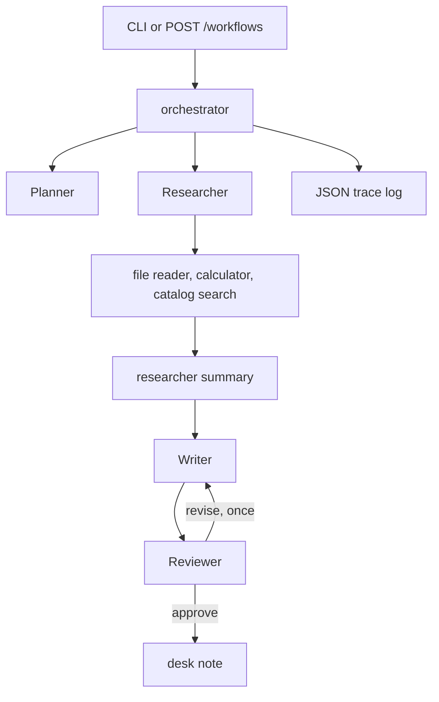

# BookNook editorial desk

**This is a demo / portfolio project.** It is a fictional bookstore desk, not a newsroom and not a client system. The agents write a short note from synthetic shelf facts. The "web search" tool reads a local catalog file. Nothing here calls the public internet unless you opt into an OpenAI-compatible model.

Four roles share one state object: a planner, a researcher, a writer, and a reviewer. The researcher asks for tools. The orchestrator runs those tools, checks the JSON each role returns, and lets the reviewer send the draft back once.

## Problem

A desk note should be planned, grounded in the shelf folder, checked for arithmetic, and rejected when it is vague. Doing that in one prompt hides failures. Splitting the work makes each hand-off a JSON object you can test.

## Architecture



Shared state holds the plan, tool observations, findings, draft, review, attempt count, and the trace.

## Features

- Planner, researcher, writer, and reviewer, each with a fixed JSON shape
- Tools: sandboxed file reader, arithmetic calculator, catalog search stub
- Retries when a tool raises, up to two attempts
- Guardrails for schema, allowed tool names, draft length, the BookNook name, and a small banned-phrase list
- Reviewer can request one revision; the writer sees those notes on the next pass
- Structured trace written to the log and returned by the API
- `MockLLM` so tests and `docker compose up` run with no API key
- CLI and a small FastAPI service

## Tech stack

- Python 3.12, FastAPI, Pydantic
- Ruff and pytest
- Docker Compose and GitHub Actions

## Quickstart

```bash
cp .env.example .env
docker compose up --build
```

Health check: http://localhost:8010/health

Without Docker:

```bash
pip install -e ".[dev]"
python -m booknook_flow.cli "Draft a short note about the four-book loan"
uvicorn booknook_flow.api:app --reload
```

## API examples

```bash
curl -X POST http://localhost:8010/workflows \
  -H "Content-Type: application/json" \
  -d "{\"task\": \"Draft a short note about the four-book loan\"}"
```

The response includes `status` (`approved` or `needs_attention`), `draft.body`, `review.verdict`, and `trace`.

Print the full state from the CLI:

```bash
python -m booknook_flow.cli --json "Draft a short note about the four-book loan"
```

Set `LLM_PROVIDER=openai` and `OPENAI_API_KEY` when you want a remote model. The remote model must return the same JSON shapes. The mock provider stays the default.

## Design decisions

- **The orchestrator owns the tools.** The researcher returns tool calls. It does not invent tool results. That keeps a bad completion from pretending it read a file.
- **JSON at every boundary.** Each role is parsed and checked before the next role runs. A missing key stops the workflow with `GuardrailError` instead of a vague paragraph.
- **Retries are narrow.** Tool calls are tried twice. The reviewer may send the draft back once (`MAX_REVISIONS`). A longer loop would hide a stuck model.
- **The calculator parses an AST.** Only arithmetic nodes are evaluated. Names, attributes, and calls are rejected, so a model cannot turn the calculator into a shell.
- **The file reader resolves the path and checks the parent.** Notes have to live in `sample_data/`. `../` does not escape.
- **Search is a stub on purpose.** A live search client would need a key and would make tests flaky. The catalog file is the stand-in, and the tool name stays `web_search` so the planner's tool list matches the real shape.
- **Mock mode is the test double and the demo.** `complete(role, instructions, payload)` is the whole provider interface. `OpenAICompatibleLLM` uses the same method.

## Roadmap

- Stream the trace over server-sent events while the desk is still writing
- Add a citation check that every number in the draft appears in a tool observation
- Persist approved notes to the shelf folder
- Swap the catalog stub for a real search client behind the same tool interface

## Tests

```bash
pytest
```

GitHub Actions runs Ruff and pytest. The suite uses `MockLLM` only.

## Related projects

- [BookNook shelf assistant](https://github.com/MiladGhorbaniG/rag-docs-assistant) — retrieval chat over shelving notes, with citations
- [BookNook Telegram desk](https://github.com/MiladGhorbaniG/telegram-miniapp-starter) — Mini App, mock membership, and FAQ bot
- [Introduction to carried out projects](https://github.com/MiladGhorbaniG/Introduction-to-carried-out-projects) — earlier work, plus the other public repositories
